Personal projects, running for real: everything on [globostofo.net](https://globostofo.net) is self-hosted on a Raspberry Pi I run myself.

### Projects

- **[Heracles](https://globostofo.net/projects/heracles/)** — My hosting platform on a Raspberry Pi 5: HTTPS proxy, unified accounts, one container per service.
- **[Brain MCP](https://github.com/Globostofo/brain-mcp)** — An MCP server that gives an AI assistant access to my notes. Every write is a git commit.
- **[Pantry MCP](https://github.com/Globostofo/pantry-mcp)** — An MCP server for Grocy: food stock, recipes, meal plan and shopping list.
- **[Heracles Backup](https://github.com/Globostofo/heracles-backup)** — Encrypted, pull-based backups of the Pi. The Pi never gets access to them.
- **[1 million libc](https://github.com/Globostofo/automatic-generation-of-1-million-libc)** — Generating musl libc variants for software diversity.

All projects, and my CV: **[globostofo.net](https://globostofo.net)**

### Activity

### Tech

`C / C++` · `Python` · `Go` · `JavaScript` · `GDScript` · `Astro` · `Docker` · `Traefik` · `Linux` · `Godot`

### Contact

[globostofo.net](https://globostofo.net) · [romain.clement2301@gmail.com](mailto:romain.clement2301@gmail.com)
